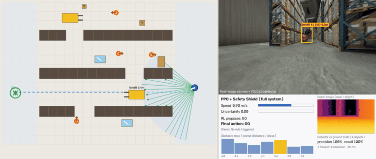
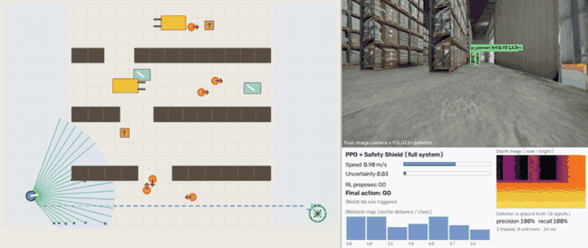
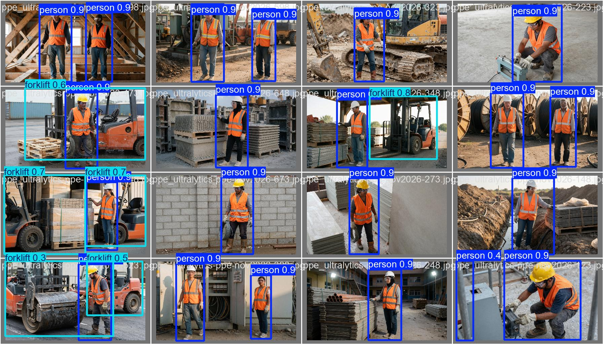
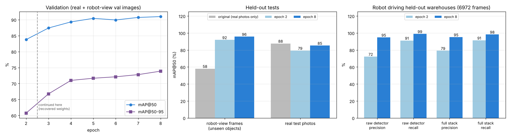
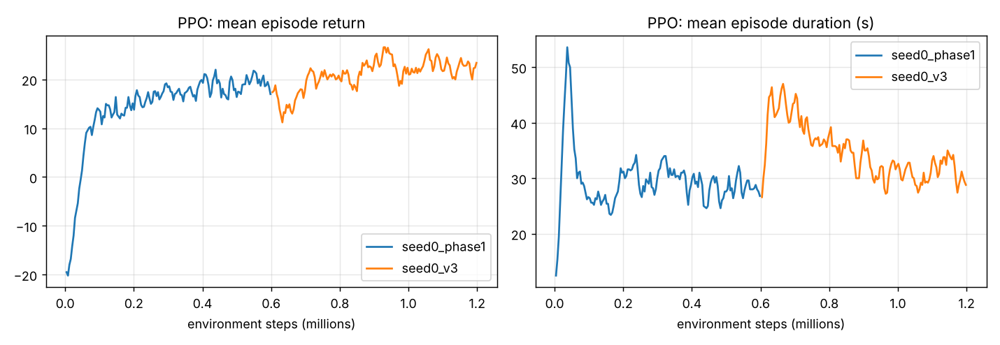

# Camera-Based Obstacle Detection for Autonomous Warehouse Robots

**Group 3 · Image and Scene Recognition**

A mobile robot drives through a simulated warehouse and detects and avoids
obstacles: workers, forklifts, pallets, shiny stretch-wrapped pallets, and
fallen boxes the detector was never trained on. It uses a camera-style
perception stack (detector + monocular depth fusion, uncertainty, tracking).
A **PPO reinforcement-learning policy** chooses the actions, and a
rule-based **safety shield** can override it.

**New: real-image camera.** The robot's camera view is built from real
warehouse photos of the detector's training datasets, and our fine-tuned
YOLO11n runs on every frame while the robot drives
([details and results](#-real-image-camera-the-simulation-runs-on-real-warehouse-photos)).



---

## 🚀 Run the interactive demo (Windows, macOS, Linux)

[](https://github.com/stevenkayitaresteven/warehouse-obstacle-detection/actions/workflows/demo-smoke-test.yml)
[](https://github.com/stevenkayitaresteven/warehouse-obstacle-detection/actions/workflows/docker.yml)

**You only need [Python 3.10 – 3.13](https://www.python.org/downloads/) and an internet connection the first time.**
No GPU and no PyTorch: the trained robot policy is a small NumPy file and the detector runs from an ONNX file. The launcher creates a private environment (`.venv/`), installs everything into it, and opens the demo in your browser. Installing takes 1–3 minutes the first time; later starts take a few seconds.

### Windows (Command Prompt / cmd)

```bat
git clone https://github.com/stevenkayitaresteven/warehouse-obstacle-detection.git
cd warehouse-obstacle-detection
run_demo.bat
```

No git? Download the ZIP from GitHub (green **Code** button → *Download ZIP*), extract it, and double-click `run_demo.bat`.

### macOS / Linux (Terminal)

```bash
git clone https://github.com/stevenkayitaresteven/warehouse-obstacle-detection.git
cd warehouse-obstacle-detection
./run_demo.sh
```

### Any OS, one command

```bash
python run_demo.py
```

(Use `python3` on macOS/Linux and `py` on Windows if `python` is not found.)

The browser opens **http://127.0.0.1:7860**. If it doesn't, paste that address into your browser. Keep the terminal window open while you present, and press **Ctrl+C** to stop.

| Option | What it does |
|---|---|
| `--check` | Install, then run a self-check (simulation, policy, web server) and exit. Good for testing the PC before class. |
| `--full` | Also install the 📷 real-image detection tab (YOLO11n + Depth Anything; installs PyTorch, which is large). |
| `--port 8000` | Use another port. If 7860 is busy, the next free port is picked automatically. |
| `--share` | Create a temporary public link, for example to open the demo on a phone. |
| `--recreate` | Delete and rebuild `.venv/` if something went wrong. |

Example: `run_demo.bat --check` (Windows) or `./run_demo.sh --check` (macOS/Linux).

### 🐳 With Docker (no Python needed)

If [Docker Desktop](https://www.docker.com/products/docker-desktop/) (Windows / macOS) or Docker Engine (Linux) is installed, the same command works everywhere: Windows cmd/PowerShell, macOS Terminal (Intel and Apple Silicon) and Linux.

```bash
git clone https://github.com/stevenkayitaresteven/warehouse-obstacle-detection.git
cd warehouse-obstacle-detection
docker compose up --build
```

Then open **http://localhost:7860**. Stop with **Ctrl+C** and clean up with `docker compose down`. The first build takes about 1–3 minutes and makes an image of about 900 MB; later starts take seconds.

| Task | Command |
|---|---|
| Start in the background | `docker compose up -d --build` |
| Check that it works (self-check) | `docker compose run --rm demo python -m src.app.selfcheck` |
| Use another port, e.g. 8080 | change `"7860:7860"` to `"8080:7860"` in `docker-compose.yml` |
| With the 📷 real-image detection tab (YOLO11n + Depth Anything, ~2 GB larger) | `docker compose --profile full up --build demo-full` |
| Without compose | `docker build -t warehouse-robot-demo .` then `docker run --rm -p 7860:7860 warehouse-robot-demo` |

The image is built and tested on every change for amd64 (Intel/AMD PCs) and arm64 (Apple Silicon), including the full variant ([Docker CI](https://github.com/stevenkayitaresteven/warehouse-obstacle-detection/actions/workflows/docker.yml)).

<details><summary>Troubleshooting</summary>

* **"Python 3.10 or newer was not found"**: install Python 3.12 from python.org. On Windows, tick *Add python.exe to PATH* in the installer, then open a **new** cmd window.
* **macOS says Python is 3.9**: that's Apple's built-in Python. Install 3.12 from python.org or run `brew install python@3.12`.
* **Ubuntu/Debian: "Could not create the virtual environment"**: run `sudo apt install python3-venv` (or `python3.12-venv`) and try again.
* **`./run_demo.sh: Permission denied`**: run `bash run_demo.sh` instead.
* **Installing packages failed**: check the internet connection, then run again with `--recreate`.
* **Docker: "port is already allocated"**: another program uses port 7860. Stop it, or change the left number in `docker-compose.yml` (`"8080:7860"`) and open http://localhost:8080.
* **Docker on Windows: "cannot connect to the Docker daemon"**: start Docker Desktop first and wait until it says *Engine running*.
* **Manual install** (if you prefer): `python -m venv .venv`, activate it, `pip install -r requirements.txt`, `python app.py`.

</details>

### What you can do in the demo

| Control | What it shows |
|---|---|
| **▶ Run / ⏸ Pause / ⏭ Step** | The robot drives live. The map, the camera view with detector boxes, the depth image, and the HUD update every frame. |
| **Robot camera** | `Real-image camera` (default): the view is built from real photos and the real YOLO11n detector runs on it. `Schematic camera`: the earlier flat-colour view with an emulated detector (faster). |
| **Click on the map** | Drops a *fallen box (unknown object)*, a *standing worker* or a *shiny pallet* in the robot's way. You can also remove obstacles. The robot reacts immediately. |
| **Controller** | `PPO + Safety Shield` (full system), `PPO only`, or the `Rule-based baseline`. |
| **Perception stack** | Ablation: `Detector only` → `+ depth fusion` → `+ uncertainty` → `+ tracking`. With *Detector only*, the robot cannot see unknown boxes and drives into them. |
| **Scenario** | *Worker steps out in front*, *Fallen boxes*, *Shiny stretch-wrapped pallets*, *Busy shift*, or a random warehouse. |
| **🎲 New warehouse** | A new random rack layout (domain randomisation). |
| **Decision log** | Every safety-shield override, with its reason (for example `GO → STOP: Person at 1.1 m`). |
| **📊 Benchmark tab** | Runs fresh evaluation episodes live and shows the saved 100-episode results. |
| **📷 Real image tab** *(optional)* | Runs YOLO11n and Depth Anything V2 on an uploaded photo. Install `requirements-perception.txt` (plus PyTorch) first. |

### Suggested 3-minute presentation script

1. **Random warehouse → ▶ Run.** The robot follows the blue global path. The
   rays show fused depth, and the right side shows what the "camera" and the
   detector see.
2. **Click a fallen box** right in front of the robot. The robot slows,
   steers around it, and the camera panel labels it `unknown (depth)`.
3. Switch **Perception → Detector only** and run again. The box is
   invisible to the detector, so the robot hits it. This is why the depth
   branch matters.
4. **Scenario → Worker steps out.** A worker appears about 1.2 m ahead. The
   shield's decision log shows `GO → STOP: Person at … m`.
5. **Scenario → Shiny stretch-wrapped pallets.** The uncertainty gauge
   turns amber or red and the robot slows down (uncertainty-aware slowdown).
6. **Benchmark tab.** Show the PPO vs. rule-based comparison and the
   ablation table.

Backup GIFs for the presentation are in [`results/demo/`](results/demo/).

## 📷 Real-image camera: the simulation runs on real warehouse photos

The robot's camera view used to be flat colour slabs with an *emulated*
detector. Now every frame is **built from real photos of the datasets the
detector was trained on**, and the **real fine-tuned YOLO11n runs on it**.
The robot still has to reach the goal and avoid obstacles; the obstacle map
(47 values), the PPO policy and the safety shield are unchanged, so this is
the sim-to-real argument of the project put to a test.



### How a frame is made

| Part of the frame | Where it comes from |
|---|---|
| Rack faces, walls with dock doors, floor, ceiling | Flat regions of real warehouse photos, warped to a front view. The rack's vanishing points are found automatically (orange beams, RANSAC over Hough lines), so beams come out level. [`scripts/build_textures.py`](scripts/build_textures.py) |
| Workers, forklifts | Cut out of real photos with SAM 2.1 from the labelled boxes. Only people with head and feet visible and not occluded are kept. [`scripts/build_sprite_bank.py`](scripts/build_sprite_bank.py) |
| Parcels | Cut out with the dataset's own segmentation polygons. |
| Unknown objects | Traffic cones, tool cases and a pallet stack from the same photos. The detector has **no class** for them. |
| Geometry | A ray caster puts the textures on the simulation's racks and walls (pinhole camera, 120° FOV, 0.6 m high) and draws every cut-out at its true distance and size, with correct occlusion. The depth of a cut-out follows the object's real footprint. [`src/simulation/photo_camera.py`](src/simulation/photo_camera.py) |

The bank is 300 cut-outs and 12 textures (5 MB, [`assets/sim/`](assets/sim/),
sources and licences in [`ATTRIBUTION.md`](assets/sim/ATTRIBUTION.md)).
Each cut-out keeps the split of its photo. **Fine-tuning used train cut-outs
only; the demo and all results below use val/test cut-outs only**, so the
detector has never seen these people, forklifts and parcels.

### Image and video processing ([`src/perception/camera_perception.py`](src/perception/camera_perception.py))

| Step | What it does |
|---|---|
| Map background subtraction | The known rack map is ray-cast into an *expected* depth image. Pixels clearly closer than expected, 0.15–1.7 m above the floor, are foreground. The threshold adapts to the depth noise measured on the floor. |
| Depth hole filling | Stretch wrap makes the depth sensor see through an object in bands. A see-through band with foreground on both sides is filled (horizontal morphological closing), and those rays are marked uncertain. |
| Depth image → range scan | Nearest return per bearing inside the robot's height band (like `depthimage_to_laserscan`). |
| Detector | Fine-tuned YOLO11n, ONNX, CPU ([`onnx_detector.py`](src/perception/onnx_detector.py)). |
| Box → metres | From the depth pixels in the box **and** from where the box touches the floor (ground-plane geometry). If they disagree, the nearer one wins. |
| Gates | A box that does not stand out from the map (a parcel on a shelf), or has an impossible physical size, is rejected. |
| Tracking | Kalman filter per object on the floor plane, compensated for the robot's own motion ([`tracking.py`](src/perception/tracking.py)). Weak detections can extend a track but never start one. |
| Unknown obstacles | Foreground that no tracked object explains. |
| Specular highlights | Saturated pixels in the obstacle band raise the uncertainty. |

The perception code only reads the RGB image, the depth image, the camera
calibration, the robot pose and the static map. The simulator's object list
is used for scoring only.

### Results (held-out objects, `python -m scripts.eval_real_image_sim`)

**Detector on the robot's camera frames** (900 frames, objects within 6 m and at least 60 % visible; boxes at conf ≥ 0.25):

| Detector | mAP@50 | Precision | Recall | person / forklift / package AP@50 |
|---|---|---|---|---|
| Before: `weights/yolo/best.pt` (trained on real photos only) | 53.9% | 80.9% | 49.3% | 94.6% / 53.8% / 13.3% |
| **After: `weights/yolo/best.onnx`** (fine-tuned on real photos + composites) | 96.6% | 77.5% | 94.5% | 99.9% / 99.1% / 90.8% |
| After, only the warehouse look that was never used for training | 95.6% | 72.2% | 93.2% | 99.9% / 98.5% / 88.4% |

**Perception stack on driving video** (5535 frames from 24 drives):

| Output | Precision | Recall | F1 |
|---|---|---|---|
| Detector alone (conf ≥ 0.25) | 77.3% | 91.2% | 83.6% |
| + tracking, without the map / size gates | 80.1% | 94.1% | 86.6% |
| + gates, without tracking | 95.7% | 87.7% | 91.5% |
| **Full stack (gates + tracking)** | **89.0%** | **94.0%** | **91.4%** |

* Distance error of detected objects: **0.09 m** mean absolute (bias -0.01 m).
* Unknown objects (cones, tool cases, pallet stack): a depth-only box overlapped the object in **73.3%** of 1230 sightings within 5.5 m. The misses are mostly objects that are small in the image; the range scan the robot drives on still saw them (no collision in the navigation test below).
* Speed: about 60 ms per frame for the whole perception stack on one CPU core (detector included), plus about 10 ms to render the frame.

**Navigation, PPO + safety shield, 60 held-out layouts** (same layouts for both rows):

| Perception | Reached goal | Collision | Time limit | Time to goal (s) |
|---|---|---|---|---|
| **Real-image camera, YOLO11n in the loop** | 73.3% | 0.0% | 26.7% | 34.8 |
| Emulated detector (what the policy was trained with) | 80.0% | 0.0% | 20.0% | 36.9 |

While driving these 60 episodes the stack's precision was 72.6% and its recall 83.7% (7169 object sightings). That is lower than on the driving video above, because in the episodes that time out the robot stands for a long time right in front of an object that is cut off by the image border, and every one of those frames is counted.

**What the numbers say, and what they do not:**

* Fine-tuning on composites was needed. The detector trained only on real
  photos found workers from the robot's viewpoint (AP 95 %) but almost no
  parcels (13 %): its parcel photos are all top-down conveyor-belt views.
* The fine-tuned ONNX detector is the *simulation's* detector. On the
  original real-photo test split it scores mAP@50 **79.3 %**, lower than
  `best.pt` (87.7 %), so `best.pt` is still the model for real photos (the
  📷 tab and the table further down). It was fine-tuned for only 2 epochs
  on a CPU (the run was interrupted); a full run is the obvious next step
  and may close that gap.
* The detector alone has 77 % precision. The map and size gates remove most
  false alarms (95.7 %). Tracking then trades some of that precision for
  recall (87.7 % → 94.0 %), because a track is kept for two frames after
  its last box.
* With the real detector in the loop the robot never collided in 60
  layouts, but it reached the goal a little less often than with the
  emulated detector (73 % vs 80 %). The policy was trained on the emulated
  obstacle map and was **not** retrained; the extra failures are time-outs.
* Three bugs found by this test and fixed: a camera at 1 m lost low objects
  when they were close (now 0.6 m); stretch-wrapped parcels were "seen
  through" in bands (now filled); a wide pallet close to the side was drawn
  outside the frame (cut-outs now cover the full footprint).
* The frames are composites: real photo material placed on simulated
  geometry, with a simulated depth sensor. Cut-outs are flat and do not
  turn or walk. This is closer to a real camera than coloured slabs, but it
  is still a simulation, not a physical-robot test.

## 🔍 Image recognition: YOLO11n fine-tuned on warehouse obstacles

We built a **3-class warehouse obstacle dataset** and fine-tuned the COCO-pretrained YOLO11n on it (25 epochs, 416 px, CPU, about 1.2 h).

| Class | Source | Train / val / test objects |
|---|---|---|
| person | Ultralytics *construction-ppe* (workers in PPE on industrial sites) | 1962 / 240 / 241 |
| forklift | Ultralytics *construction-ppe* | 275 / 37 / 36 |
| package | Ultralytics *package-seg* (parcels; polygons converted to boxes) | 3100 / 693 / 325 |

Images: 1,699 train · 288 val · 189 test. Test images are never used for training.

**Test-set results** (`python -m scripts.eval_yolo --weights weights/yolo/best.pt`):

| Metric | Value |
|---|---|
| mAP@50 | **87.7%** |
| mAP@50-95 | 67.4% |
| Precision / recall | 88.1% / 84.0% |
| CPU speed (416 px) | 27 FPS |

| AP@50 per class | COCO-pretrained (before) | Fine-tuned (after) |
|---|---|---|
| person | 74.7% | 87.8% |
| forklift | 0% (no such class) | 81.0% |
| package | 0% (no such class) | 95.5% |



Plots: [confusion matrix](results/graphs/yolo_confusion_matrix_test.png) · [PR curve](results/graphs/yolo_pr_curve_test.png) · [training curves](results/graphs/yolo_training_curves.png). Weights: `weights/yolo/best.pt` (used by the demo's **📷 Real image detection** tab).

Reproduce:

```bash
pip install -r requirements-perception.txt
python -m scripts.build_warehouse_dataset --src data_downloads --download --out datasets/processed/warehouse3
python training/train_yolo.py --data datasets/processed/warehouse3/data.yaml --weights yolo11n.pt --epochs 25 --imgsz 416 --batch 16 --device cpu --output results/yolo_warehouse --name yolo11n_warehouse3
python -m scripts.eval_yolo --weights weights/yolo/best.pt
```

*Why not LOCO yet?* LOCO's download server could not be reached from our training machine, so this week we used the public Ultralytics datasets above. `scripts/prepare_loco.py` + `training/train_yolo.py` train on LOCO (pallets, stillages, small load carriers) on Colab; that is next week's plan. Dataset licences: see the Ultralytics dataset pages (construction-ppe, package-seg).

## 📷 Real-image camera: the detector fine-tuned for the robot's view

With the **real-image camera** (the demo's default), every frame the robot sees is built from real photos: rack, floor and wall photos, plus real cut-outs of workers, forklifts and parcels. YOLO11n runs on every frame. Photos taken by people look different from a camera 0.6 m above the floor in a rack aisle, so the detector was **fine-tuned for the robot's view**:

* **Training data:** the 1,699 real training photos above, plus 2,400 robot-view frames (`scripts/make_sim_dataset.py`) built only from cut-outs of *training* photos, in warehouse looks a and b.
* **8 epochs** on a CPU. Epochs 1–2 were trained earlier, but only their ONNX export survived. `scripts/recover_onnx_weights.py` turned it back into a trainable checkpoint that reproduces the ONNX outputs to within 6e-4 px. Epochs 3–8 continued from there (1.3 h, AdamW, lr 0.001 → 0.0001).
* **Held-out tests:**
  * 600 robot-view frames with objects the detector never saw (val/test cut-outs), in warehouse looks a, b and c (c was never used for training);
  * the 189 real test photos.

| Detector | Robot-view frames, mAP@50 (precision / recall) | Real test photos, mAP@50 |
|---|---|---|
| Original (real photos only, `best.pt`) | 58.0% (75.5% / 46.4%) | **87.7%** |
| Robot-view, epoch 2 | 91.9% (94.9% / 82.2%) | 79.3% |
| **Robot-view, epoch 8** (`best.onnx`) | **95.7% (97.4% / 91.9%)** | 85.2% |

**With the robot driving.** The robot drove 30 held-out warehouses, and each of the 6,972 camera frames was scored against the simulator's ground truth (`python -m scripts.eval_real_image_sim --no-emulated`):

| | Epoch 2 | **Epoch 8** |
|---|---|---|
| Raw detector: precision / recall / mAP@50 | 72.2% / 91.1% / 89.8% | **94.8% / 99.0% / 98.9%** |
| False alarms / missed objects | 1,637 / 414 | **255 / 49** |
| Full perception stack (depth gates + tracking): precision / recall | 79.2% / 91.3% | **95.1% / 98.3%** |
| Demo HUD during 40 navigation runs: precision / recall | 66.0% / 81.2% | **93.5% / 98.3%** |



**What did not change:** navigation with the camera in the loop. Over 40 held-out episodes, 62.5% reached the goal, 10% collided and 27.5% timed out, with **both** detectors. So the remaining failures are not detection failures:

* **Collisions:** mostly pallets right *beside* the robot, which leave the 120° field of view while it turns (a blind spot).
* **Time-outs:** the robot waits in front of obstacles instead of driving around them.

The policy was trained on the emulated perception. Fixing these failures is the next step (longer memory of obstacles outside the field of view, and fine-tuning the policy with the camera in the loop).

`best.pt` (real photos) still powers the 📷 *Real image detection* tab, because it is better on real photos. `best.onnx` (epoch 8) is the robot's camera detector. `weights/yolo/robotview.pt` is the epoch-8 PyTorch checkpoint for further training. All numbers are in [`results/metrics/detector_finetune.json`](results/metrics/detector_finetune.json), and the per-epoch log is in [`results/metrics/yolo_robotview_results.csv`](results/metrics/yolo_robotview_results.csv).

<details><summary>Reproduce the robot-view fine-tuning</summary>

```bash
pip install -r requirements-perception.txt                  # ultralytics + torch
python -m scripts.build_warehouse_dataset --src data_downloads --download --out datasets/processed/warehouse3
python -m scripts.make_sim_dataset --out datasets/processed/simcam --split train --frames 2400 --sprites train --styles a,b --seed0 500000
python -m scripts.make_sim_dataset --out datasets/processed/simcam --split val --frames 300 --sprites train --styles a,b --seed0 600000
python -m scripts.make_sim_dataset --out datasets/processed/simcam --split test --frames 600 --sprites val,test --styles a,b,c --seed0 900000
# data_v2.yaml: train = warehouse3/images/train + simcam/images/train, val = warehouse3/images/val + simcam/images/val
# what was done here: recover the epoch-2 weights from ONNX, then train epochs 3-8
python scripts/recover_onnx_weights.py --onnx <epoch-2 best.onnx> --ref weights/yolo/best.pt --images datasets/processed/simcam/images/train datasets/processed/warehouse3/images/train --out recovered_epoch2.pt
yolo detect train model=recovered_epoch2.pt data=datasets/processed/data_v2.yaml epochs=6 imgsz=640 batch=16 device=cpu optimizer=AdamW lr0=0.001 lrf=0.1 warmup_epochs=0.5 warmup_bias_lr=0.001 close_mosaic=2 seed=0
yolo export model=runs/detect/train/weights/best.pt format=onnx imgsz=384,640 opset=12 simplify=True
python -m scripts.eval_real_image_sim --onnx runs/detect/train/weights/best.onnx --out results/metrics/real_image_eval_new.json --no-emulated
python -m scripts.plot_detector_finetune
```

To train further, start from `weights/yolo/robotview.pt` (epoch 8) instead of the recovered weights, with a smaller learning rate (for example `lr0=0.0005`).

</details>

---

## 🧠 System design

```
Camera (simulated, 120° FOV)
 ├─ Detector branch  (person / pallet / forklift, can miss)      ┐
 ├─ Depth branch     (any surface; noise, shadows, mirror fails) ├─► Fusion & reasoning ─► obstacle map (47-D state)
 │                                                               ┘   · box-median distance per detection
 │                                                                   · depth-only returns → "unknown obstacle"
 │                                                                   · uncertainty: temporal jumps + detector/depth
 │                                                                     disagreement + specular highlights
 │                                                                   · tracking: 3-frame median + closing speed
 ▼
PPO policy (SB3, MLP 2×64 tanh) ─► GO / SLOW / STOP / TURN_LEFT / TURN_RIGHT
 ▼
Safety shield: 1) hard stop on the predicted arc  2) person priority
               3) uncertainty override  4) otherwise allow  (+ decision log, recovery turn)
 ▼
Motors (unicycle model, acceleration and braking limits)
```

| Piece | File |
|---|---|
| Gymnasium warehouse environment, perception emulation, reward | [`src/simulation/warehouse_env.py`](src/simulation/warehouse_env.py) |
| Renderer (map, camera view, depth strip, HUD) | [`src/simulation/render.py`](src/simulation/render.py) |
| Safety shield and decision log | [`src/safety/shield.py`](src/safety/shield.py) |
| Rule-based baseline, NumPy PPO policy, SB3 export | [`src/navigation/controllers.py`](src/navigation/controllers.py) |
| PPO training | [`training/train_ppo.py`](training/train_ppo.py) |
| Evaluation (RL vs. rules, ablation, shield tests, seeds) | [`scripts/evaluate_navigation.py`](scripts/evaluate_navigation.py) |
| Gradio demo | [`src/app/app.py`](src/app/app.py), [`app.py`](app.py) |
| Real-image perception (YOLO11n + Depth Anything V2) | [`src/perception/`](src/perception/) |
| Real-image camera (renderer, image/video processing, tracking) | [`src/simulation/photo_camera.py`](src/simulation/photo_camera.py), [`src/perception/camera_perception.py`](src/perception/camera_perception.py), [`src/perception/tracking.py`](src/perception/tracking.py) |

### Reinforcement-learning set-up

| RL element | Implementation |
|---|---|
| State | 21 fused depth rays, 7 sector distances, 7 sector classes (person or forklift), 7 closing speeds, direction to the next path waypoint (sin, cos), goal distance, speed, uncertainty. 47 values in [-1, 1]. |
| Actions | GO (1.5 m/s), SLOW (0.6 m/s), STOP, TURN_LEFT, TURN_RIGHT |
| Reward | + progress along the global path · +10 goal · −10 collision · − near-miss (wider margin around people) · − harsh braking · −0.01 per step |
| Algorithm | PPO, Stable-Baselines3, 4 parallel environments, 1.2 M steps, lr 3e-4, n_steps 1024, batch 512, γ 0.99, GAE λ 0.95, clip 0.2, entropy 0.01 |
| Domain randomisation | Rack layout, cross-aisles, obstacle counts and speeds, depth noise, detector recall (80–97 %), shadow false returns, share of reflective pallets |
| Global path | Grid distance field (Dijkstra) over the *static* rack map. Workers, forklifts, pallets and boxes are **not** on the map. **Event-triggered replanning:** when perceived obstacles block the next 3.5 m of the path for 3 frames, the planner adds them as high-cost regions and replans around them, the same way a costmap is updated from sensors in a real AMR stack. |
| Training schedule | Phase 1: 600 k steps with the static global path only. The policy learned to stop safely, but it got stuck behind pallets lying on the path. Phase 2: continued from that checkpoint to 1.2 M steps with replanning enabled. A first phase-2 attempt measured progress on the *replanned* field, and the policy learned to drive in circles to farm reward (reward hacking). Progress is now measured on the static map distance. |

---

## 📊 Results (simulation)

Evaluation: 100 episodes per row on held-out random layouts (`python -m scripts.evaluate_navigation`). Trained policy: 1.2 M PPO steps (seed 0).

#### RL vs rule-based baseline

| Controller | Reached goal | Collision | Time limit | Time to goal (s) |
|---|---|---|---|---|
| **PPO + safety shield (full system)** | 82% | 0% | 18% | 37.6 |
| PPO only | 86% | 8% | 6% | 27.6 |
| Rule-based baseline (stop if < 1 m) | 55% | 38% | 7% | 29.6 |
| Rule-based + shield | 63% | 0% | 37% | 45.7 |

#### Perception ablation (PPO + shield)

| Perception | Reached goal | Collision | Collisions by class |
|---|---|---|---|
| Detector only (existing method) | 53% | 41% | {'unknown': 41} |
| + depth fusion | 73% | 0% | - |
| + uncertainty slowdown | 67% | 0% | - |
| + tracking (full system) | 82% | 0% | - |

#### Reflective hard cases (every pallet stretch-wrapped)

| Perception | Reached goal | Collision |
|---|---|---|
| + depth fusion | 68% | 0% |
| + uncertainty slowdown | 64% | 0% |
| + tracking (full system) | 77% | 0% |

#### Perception metrics (`python -m scripts.perception_metrics`)

* Obstacle recall (an obstacle within 5.5 m is reported as anything): detector only **73.2%** vs fusion **99.9%**. Unknown fallen boxes: 0% vs 100%.
* Uncertainty score near pallets: normal 0.09 (slowdown 3% of frames) vs stretch-wrapped 0.51 (slowdown 87%).
* Safety shield, scripted "worker steps out at about 1 m": collision prevented in **100%** of 50 scenes.
* Policy + shield decision time: 0.21 ms per frame (NumPy, CPU).

**Where it still fails:** the remaining failures with the shield are time-outs, not crashes. The robot waits behind a worker or hesitates in narrow gaps. Uncertainty alone costs some success, because it slows the robot near shiny pallets; tracking recovers it. The numbers in this section use the *emulated* detector branch (a stand-in with 80–97 % recall), which is also what the PPO policy was trained with. The [real-image camera](#-real-image-camera-the-simulation-runs-on-real-warehouse-photos) section reports the same robot with the real YOLO11n in the loop.

*These are simulation results on held-out random layouts (seeds not used in
training). They are not physical-robot results.*



---

## 🔁 Reproduce

```bash
pip install -r requirements.txt -r requirements-train.txt
python -m training.train_ppo --timesteps 1200000 --seed 0 --export-npz   # ~30-40 min on 4 CPU cores
python -m training.train_ppo --timesteps 1200000 --seed 1                 # optional: more seeds
python -m scripts.plot_training logs/train_seed0.log
python -m scripts.perception_metrics
python -m scripts.evaluate_navigation --episodes 100
python -m scripts.record_demo
python -m unittest discover -s tests -t .
```

`--export-npz` writes `models/ppo_warehouse_policy.npz`, which is the file
the demo loads.

### Real-image camera

The demo only needs the committed files (`assets/sim/`, `weights/yolo/best.onnx`).
To rebuild them from the datasets:

```bash
pip install -r requirements.txt -r requirements-perception.txt
python -m scripts.build_warehouse_dataset --src data_downloads --download --out datasets/processed/warehouse3
python scripts/build_sprite_bank.py --src data_downloads --dataset datasets/processed/warehouse3 --out assets/sim/sprites   # SAM 2.1 cut-outs
python scripts/build_textures.py --src data_downloads --out assets/sim/textures                                             # rectified textures
python -m scripts.make_sim_dataset --out datasets/processed/simcam --split train --frames 2600 --sprites train --styles a,b
python -m scripts.make_sim_dataset --out datasets/processed/simcam --split val --frames 300 --sprites val --styles a,b --seed0 800000
python training/finetune_sim_detector.py --epochs 8      # writes weights/yolo/best.onnx
python -m scripts.eval_real_image_sim --episodes 60      # writes results/metrics/real_image_eval.json
python -m scripts.record_demo --real-only                # results/demo/demo_real_camera*.gif
```

### Detector training (Colab, LOCO dataset)

The earlier perception pipeline is still included:

* `scripts/prepare_loco.py` converts LOCO COCO annotations to YOLO format.
* `training/train_yolo.py` fine-tunes YOLO11n.
* `src/perception/` holds the detector, the Depth Anything V2 wrapper and
  the box–depth fusion code.

The first YOLO11n baseline on 5 LOCO classes reached mAP@50 31.7 % and
mAP@50-95 13.7 % (precision 41.4 %, recall 35.0 %). This is a baseline, not
final performance. To use the trained detector in the demo's real-image
tab, copy `best.pt` to `weights/yolo/best.pt`.

## 📑 Weekly-progress slides

[`presentation/Group3_Weekly_Progress.pptx`](presentation/Group3_Weekly_Progress.pptx) is a 6-slide deck with speaker notes. Every chart in it comes from the metric files above. To regenerate it:

```bash
python -m presentation.collect_data
npm install pptxgenjs react-icons react react-dom sharp
node presentation/build_deck.js
```

## Repository structure

- `app.py`: demo entry point
- `src/simulation/`: warehouse environment, renderer, real-image camera
- `src/navigation/`: controllers (PPO in NumPy, rule-based baseline)
- `src/safety/`: safety shield
- `src/perception/`: YOLO detector (PyTorch and ONNX), Depth Anything V2, fusion, live pipeline, camera perception and tracking for the real-image camera
- `assets/sim/`: real cut-outs and textures for the real-image camera
- `src/evaluation/`: episode runner and metrics
- `src/app/`: Gradio demo
- `training/`: PPO and YOLO training
- `scripts/`: data preparation, evaluation, plotting, GIF recording
- `models/`: trained PPO policy (committed, small)
- `results/`: metrics, graphs, demo GIFs
- `tests/`: unit tests

## Academic integrity

Measured results are kept separate from targets. Simulation results are
kept separate from physical-robot tests. Depth Anything V2 gives
*relative* depth, not calibrated metres.
