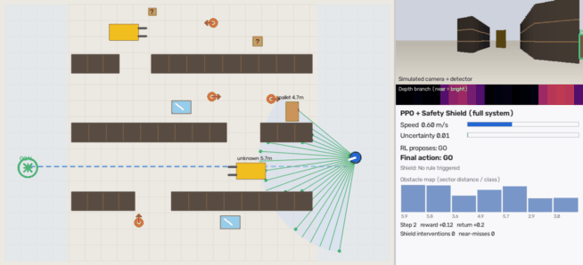
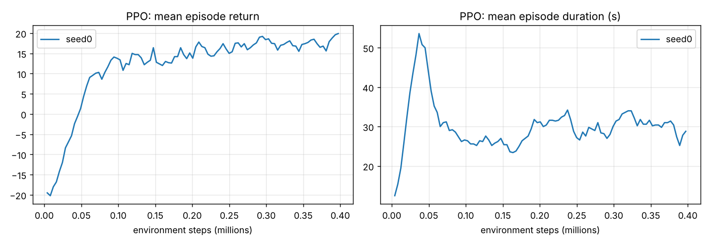

# Camera-Based Obstacle Detection for Autonomous Warehouse Robots

**Group 3 · Image and Scene Recognition**

A mobile robot drives through a simulated warehouse and detects and avoids
obstacles: workers, forklifts, pallets, shiny stretch-wrapped pallets, and
fallen boxes the detector was never trained on. It uses a camera-style
perception stack (detector + monocular depth fusion, uncertainty, tracking).
A **PPO reinforcement-learning policy** chooses the actions, and a
rule-based **safety shield** can override it.



---

## 🚀 Run the interactive demo (any PC: Windows, macOS, Linux)

You need **Python 3.9 – 3.13**. No GPU and **no PyTorch** are needed: the
trained PPO policy is shipped as a small NumPy file.

```bash
git clone https://github.com/stevenkayitaresteven/warehouse-obstacle-detection.git
cd warehouse-obstacle-detection
python -m venv .venv
```

Activate the virtual environment:

* Windows (PowerShell): `.venv\Scripts\Activate.ps1`
* Windows (cmd): `.venv\Scripts\activate.bat`
* macOS / Linux: `source .venv/bin/activate`

Then install and run:

```bash
pip install -r requirements.txt
python app.py
```

Your browser opens **http://127.0.0.1:7860**. If it does not open on its
own, paste that address into your browser. To show the demo from another
device, run `python app.py --share`, which creates a temporary public link.

### What you can do in the demo

| Control | What it shows |
|---|---|
| **▶ Run / ⏸ Pause / ⏭ Step** | The robot drives live. The map, the simulated camera with detector boxes, the depth strip, and the HUD update every frame. |
| **Click on the map** | Drops a *fallen box (unknown object)*, a *standing worker* or a *shiny pallet* in the robot's way. You can also remove obstacles. The robot reacts immediately. |
| **Controller** | `PPO + Safety Shield` (full system), `PPO only`, or the `Rule-based baseline`. |
| **Perception stack** | Ablation: `Detector only` → `+ depth fusion` → `+ uncertainty` → `+ tracking`. With *Detector only*, the robot cannot see unknown boxes and drives into them. |
| **Scenario** | *Worker steps out in front*, *Fallen boxes*, *Shiny stretch-wrapped pallets*, *Busy shift*, or a random warehouse. |
| **🎲 New warehouse** | A new random rack layout (domain randomisation). |
| **Decision log** | Every safety-shield override, with its reason (for example `GO → STOP: Person at 1.1 m`). |
| **📊 Benchmark tab** | Runs fresh evaluation episodes live and shows the saved 100-episode results. |
| **📷 Real image tab** *(optional)* | Runs YOLO11n and Depth Anything V2 on an uploaded photo. Install `requirements-perception.txt` (plus PyTorch) first. |

### Suggested 3-minute presentation script

1. **Random warehouse → ▶ Run.** The robot follows the blue global path. The
   rays show fused depth, and the right side shows what the "camera" and the
   detector see.
2. **Click a fallen box** right in front of the robot. The robot slows,
   steers around it, and the camera panel labels it `unknown (depth)`.
3. Switch **Perception → Detector only** and run again. The box is
   invisible to the detector, so the robot hits it. This is why the depth
   branch matters.
4. **Scenario → Worker steps out.** A worker appears about 1.2 m ahead. The
   shield's decision log shows `GO → STOP: Person at … m`.
5. **Scenario → Shiny stretch-wrapped pallets.** The uncertainty gauge
   turns amber or red and the robot slows down (uncertainty-aware slowdown).
6. **Benchmark tab.** Show the PPO vs. rule-based comparison and the
   ablation table.

Backup GIFs for the presentation are in [`results/demo/`](results/demo/).

---

## 🧠 System design

```
Camera (simulated, 120° FOV)
 ├─ Detector branch  (person / pallet / forklift, can miss)      ┐
 ├─ Depth branch     (any surface; noise, shadows, mirror fails) ├─► Fusion & reasoning ─► obstacle map (47-D state)
 │                                                               ┘   · box-median distance per detection
 │                                                                   · depth-only returns → "unknown obstacle"
 │                                                                   · uncertainty: temporal jumps + detector/depth
 │                                                                     disagreement + specular highlights
 │                                                                   · tracking: 3-frame median + closing speed
 ▼
PPO policy (SB3, MLP 2×64 tanh) ─► GO / SLOW / STOP / TURN_LEFT / TURN_RIGHT
 ▼
Safety shield: 1) hard stop on the predicted arc  2) person priority
               3) uncertainty override  4) otherwise allow  (+ decision log, recovery turn)
 ▼
Motors (unicycle model, acceleration and braking limits)
```

| Piece | File |
|---|---|
| Gymnasium warehouse environment, perception emulation, reward | [`src/simulation/warehouse_env.py`](src/simulation/warehouse_env.py) |
| Renderer (map, camera view, depth strip, HUD) | [`src/simulation/render.py`](src/simulation/render.py) |
| Safety shield and decision log | [`src/safety/shield.py`](src/safety/shield.py) |
| Rule-based baseline, NumPy PPO policy, SB3 export | [`src/navigation/controllers.py`](src/navigation/controllers.py) |
| PPO training | [`training/train_ppo.py`](training/train_ppo.py) |
| Evaluation (RL vs. rules, ablation, shield tests, seeds) | [`scripts/evaluate_navigation.py`](scripts/evaluate_navigation.py) |
| Gradio demo | [`src/app/app.py`](src/app/app.py), [`app.py`](app.py) |
| Real-image perception (YOLO11n + Depth Anything V2) | [`src/perception/`](src/perception/) |

### Reinforcement-learning set-up

| RL element | Implementation |
|---|---|
| State | 21 fused depth rays, 7 sector distances, 7 sector classes (person or forklift), 7 closing speeds, direction to the next path waypoint (sin, cos), goal distance, speed, uncertainty. 47 values in [-1, 1]. |
| Actions | GO (1.5 m/s), SLOW (0.6 m/s), STOP, TURN_LEFT, TURN_RIGHT |
| Reward | + progress along the global path · +10 goal · −10 collision · − near-miss (wider margin around people) · − harsh braking · −0.01 per step |
| Algorithm | PPO, Stable-Baselines3, 8 parallel environments, 2 M steps |
| Domain randomisation | Rack layout, cross-aisles, obstacle counts and speeds, depth noise, detector recall (80–97 %), shadow false returns, share of reflective pallets |
| Global path | Grid distance field (Dijkstra) over the *static* rack map. Workers, forklifts, pallets and boxes are **not** on the map, so the policy must avoid them using perception alone. |

---

## 📊 Results (simulation)

RESULTS_PLACEHOLDER

*These are simulation results on held-out random layouts (seeds not used in
training). They are not physical-robot results.*



---

## 🔁 Reproduce

```bash
pip install -r requirements.txt -r requirements-train.txt
python -m training.train_ppo --timesteps 2000000 --seed 0 --export-npz   # ~1 h on 4 CPU cores
python -m training.train_ppo --timesteps 2000000 --seed 1                 # optional: more seeds
python -m scripts.plot_training logs/train_seed0.log
python -m scripts.evaluate_navigation --episodes 100
python -m scripts.record_demo
python -m unittest discover -s tests -t .
```

`--export-npz` writes `models/ppo_warehouse_policy.npz`, which is the file
the demo loads.

### Detector training (Colab, LOCO dataset)

The earlier perception pipeline is still included:

* `scripts/prepare_loco.py` converts LOCO COCO annotations to YOLO format.
* `training/train_yolo.py` fine-tunes YOLO11n.
* `src/perception/` holds the detector, the Depth Anything V2 wrapper and
  the box–depth fusion code.

The first YOLO11n baseline on 5 LOCO classes reached mAP@50 31.7 % and
mAP@50-95 13.7 % (precision 41.4 %, recall 35.0 %). This is a baseline, not
final performance. To use the trained detector in the demo's real-image
tab, copy `best.pt` to `weights/yolo/best.pt`.

## Repository structure

- `app.py`: demo entry point
- `src/simulation/`: warehouse environment and renderer
- `src/navigation/`: controllers (PPO in NumPy, rule-based baseline)
- `src/safety/`: safety shield
- `src/perception/`: YOLO detector, Depth Anything V2, fusion, live pipeline
- `src/evaluation/`: episode runner and metrics
- `src/app/`: Gradio demo
- `training/`: PPO and YOLO training
- `scripts/`: data preparation, evaluation, plotting, GIF recording
- `models/`: trained PPO policy (committed, small)
- `results/`: metrics, graphs, demo GIFs
- `tests/`: unit tests

## Academic integrity

Measured results are kept separate from targets. Simulation results are
kept separate from physical-robot tests. Depth Anything V2 gives
*relative* depth, not calibrated metres.
